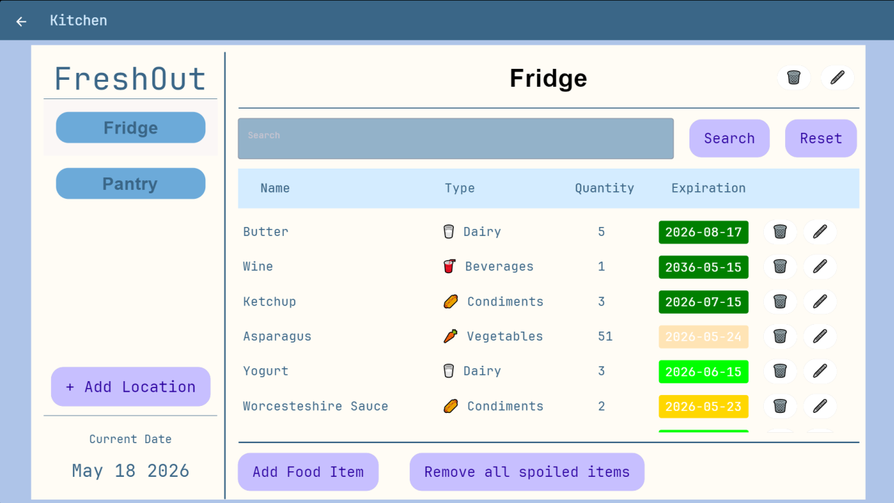
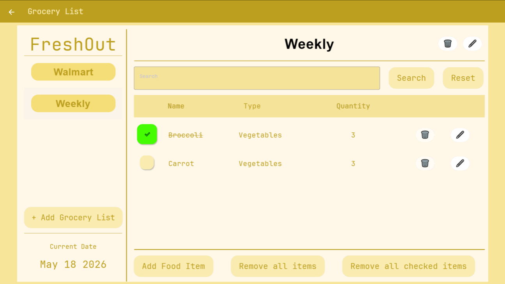

# FreshOut


In our app *FreshOut*, users can login or register to make two types of lists:

- `LocationList`s are different places in the user’s kitchen—i.e. a fridge or a pantry—for users to input as many `FoodItem`s—i.e. milk or cookies—they have in those locations and track the expiration dates of these items based on the color-coded dates.  
- `GroceryList`s are regular lists where users can input what `FoodItem`s they need to buy at the grocery and click a checkbox if the item is already in their cart or if they already paid for it.

---

## Isabela’s contributions

This Dawson College project was built by a team of three. Isabela integrated PostgreSQL persistence with Entity Framework Core and configured .NET user secrets. She also implemented navigation that passes user data between pages, item deletion, and dedicated editing pages.

## Quick start

Use Visual Studio on Windows with the .NET 9 SDK and the Uno Platform prerequisites. Create a local PostgreSQL database and configure the connection from the repository root:

```bash
dotnet user-secrets set "ConnectionString" "Host=localhost;Port=5432;Database=freshout;Username=LOCAL_USER;Password=LOCAL_PASSWORD" --project Data/Data.csproj
```

Replace the placeholders with your local credentials. With the EF Core 9 CLI tools installed, apply the existing migrations:

```bash
dotnet ef database update --project Data/Data.csproj --startup-project Data/Data.csproj
```

Open `FreshOut/FreshOut.sln` in Visual Studio and launch the desktop profile.

## Demo data

Register a local account named `freshout-demo` in the app. Choose your own password and a profile picture. With PostgreSQL's client tools installed, run the following command against the same local database configured above:

```bash
psql -X -v ON_ERROR_STOP=1 -h localhost -U LOCAL_USER -d freshout -f db/demo.sql
```

Sign in as `freshout-demo` to see a fridge and pantry with expired, nearly expired, and fresh items, plus a grocery list with checked and unchecked items. The seed requires an empty demo account.

## Built With

- For best experience, use Windows 11
- Programming Language(s): C#  
- .NET 9.0  
- Entity Framework + PostgreSQL
- Uno Platform  
- Visual Studio

---

## Features

### Registration

- Verifies that the user follows registration requirements  
  - Username must be at least 3 characters  
  - Password must be at least 8 characters  
  - Password must be written twice and password confirm must match the original password  
- Dropdown of profile pictures for added personalization  
- Ability to navigate to the `Login` page

### Login

- Checks for valid credentials  
- Ability to navigate to the `Registration` page

### Main

- Base page for navigating to `Login`, `Kitchen` and `GroceryList` pages  
- Displays user’s profile picture and username

### Kitchen



- Add/delete a new `LocationList`  
- Edit and update an existing `LocationList`  
- Add/delete new `FoodItem`s  
  - For adding, users can input the `FoodItem`’s name, quantity, food category, and expiration date.  
  - For deleting, users can choose to delete individual `FoodItem`s, or just spoiled ones  
- Edit and update existing `FoodItem`s  
- Insensitive-case searching  
- Alphabetical sorting by name  
- Numerical sorting by quantity and expiration date  
- Reset `LocationList` to clear search and go back to original sorting  
- Ability to navigate to the `Main`, `AddLocationItem`, and `EditItem` pages

### Grocery Lists



- Add/delete a new `GroceryList`  
- Edit and update an existing `GroceryList` 
- Add/delete new `FoodItem`s  
  - For adding, users can input the `FoodItem`’s name, quantity, and food category.  
  - For deleting, users can choose to delete individual `FoodItem`s or all of them  
- Edit and update existing `FoodItem`s  
- Insensitive-case searching  
- Alphabetical sorting by name  
- Numerical sorting by quantity  
- Reset `GroceryList` to clear search and go back to original sorting  
- Check off a `FoodItem`  
- Ability to navigate to the `Main`, `AddGroceryItem`, and `EditItem` pages

---

## Authors

- Isabela Resende Vasconcelos
- Xena Tat
- Jiha Poitevin

README.md template adapted from https://www.makeareadme.com/  
